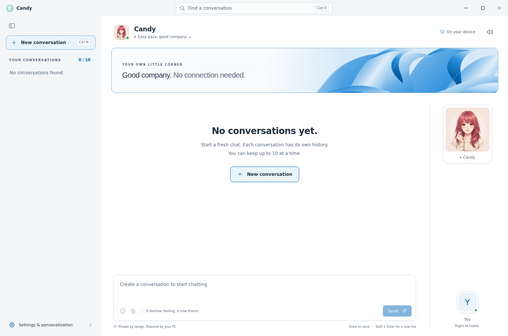

<p align="center"></p>

# Candy 1.0
### Your offline AI chatmate for Windows 11 — by KnightWin

**Candy is an offline AI chatmate. It uses the internet only when you explicitly run Setup Candy to download the necessary files for Candy to function properly—nothing else.**

Chats run on your own PC. No cloud conversations, accounts, advertisements, analytics, telemetry or automatic update checks. Once setup is complete, disconnect from the internet and keep chatting. Candy's private loopback connection to its local AI engine is **not** an internet connection.

## Screenshots 




## Get started

1. Download **Candy-Portable-1.0.0-x64.exe** from this repository's Releases page.
2. Run it on a **Windows 11 Intel/AMD x64 PC**. ARM64 is not supported by this build.
3. Choose **Setup Candy** to download and verify the required model, local AI runtime and Microsoft app-local C++ runtime files. Allow roughly **1–3 GB of downloads**, depending on the model.
4. When setup finishes, create a conversation and say hello. No further internet access is needed for chatting.

Minimum **4 GB RAM**; **8 GB or more recommended**, with 12 GB+ preferable for the larger model. Keep several GB of free disk space. Candy automatically tries compatible **Vulkan GPU acceleration first**, then falls back to CPU. Choose the smaller model or CPU compatibility in **Settings → Device & data** if necessary. Candy does not install GPU drivers or system-wide runtime packages.

This release is **unsigned**. Windows may show an unknown-publisher/SmartScreen warning; run it only if you trust the source. KnightWin is the author/company metadata, not a claim of a verified signing certificate.

## What Candy can do

| Feature | How it works |
| --- | --- |
| Offline conversations | Local AI responses and saved chat history; no web browsing or cloud processing. Answers can be inaccurate—verify important information. |
| Conversation management | Up to **10** separate conversations, search, confirmed whole-conversation deletion and JSON export. The last conversation can be deleted without creating a replacement. |
| Natural reply pacing | A brief thinking animation; only the **finished reply** appears. Stop discards an unfinished or still-hidden answer. |
| Personas and humor | **Friendly**, **Thoughtful**, **Creative** and **Focused**, with an adjustable humor level. Changing persona retains your numeric humor setting. |
| Display pictures | Built-in Candy/user avatars, plus a local PNG/JPEG user picture. Two animated Candy choices: **Finger-heart girl** and **Tail-wiggle cat**. The developer avatar is available only with Focused. The app icon stays the original Candy mascot. |
| Themes and scenes | Light, dark or system appearance; ten scenes including device-accent Windows silk, Beach, Sakura and Matrix. Four bubble styles: Outlined, Solid, Fruit and Metro. |
| Windows 11 styling | Compact collapsible sidebar, centered search and subtle acrylic on supported Windows 11 22H2+ systems, with a readable solid fallback. |
| Chat sounds and nudge | Original subtle sent/received cues (on by default) and a playful shake/chime. **Settings → Voice** has an independent chat-sounds mute and previews. Nudge preserves your draft and never sends it automatically. |
| Optional spoken replies | Windows' installed offline **System.Speech** voices, with voice and pace controls. Some Windows natural voices are incompatible. No microphone input or voice recording. |
| Accessibility | Keyboard navigation, contrast-aware accents, reduced-motion support and still-image fallbacks for animated avatars. Windows Animation effects must be on to see the nudge shake. |

The composer includes an emoji picker, and the playful mood line is decorative—not a claim of real feelings. **Device & data** shows hardware information, model/backend choices and setup/progress/cancel controls. AI chat is text-only: Candy cannot browse websites, see images, create media files or execute code for you.

**Shortcuts:** Ctrl+N creates a conversation; Ctrl+F or Ctrl+K focuses search; Escape clears focused search or dismisses Settings. Window controls remain usable while Settings is open.

Custom user pictures must be PNG/JPEG, at most **10 MB / 4096 × 4096**. Candy saves its own resized copy; your original is never changed or uploaded. Changing scenes, avatars or personas does not download anything.

## Your data and privacy

- Candy stores chats, settings, custom-picture copies, downloaded models/runtime and its cache under **`%APPDATA%\CandyLocal`**.
- Explicit setup downloads come from the allowlisted official GitHub, Hugging Face and Microsoft hosts/CDNs. SHA-256 checks verify pinned files before use. Download providers receive normal connection information, such as your IP address and requested file—not your chats.
- The renderer cannot access external websites; the AI server listens only on `127.0.0.1`, requires a random local API key and is stopped when Candy closes.
- **Clear & reset permanently deletes ALL Candy-managed data** in that folder, including models, chats and settings. Candy closes completely, never restarts automatically and does **not** delete the app/EXE. Export important chats first. External originals, exports and backups remain. This is deletion, not forensic secure erasure.

[Privacy details](PRIVACY.md) · [Third-party notices](THIRD-PARTY.md)

## Updating or moving the app

Close the old Candy completely, then open the new EXE. Existing `%APPDATA%\CandyLocal` data is reused, including data from the experimental builds. **Do not reset to update.** No model reinstall is needed for an already completed compatible setup.

The executable can be moved, but its data stays in the Windows profile folder above. It is not a fully self-contained USB data installation.

## Build from source

Extract **Candy-source-1.0.0.zip**, open its `Candy-1.0.0` folder and install **Node.js 24 or newer**. Building needs internet access for developer dependencies; that is separate from the installed app's setup-only network policy.

```powershell
npm ci --no-audit --no-fund
npm test
npm run build:win
npm run release:prepare
npm run release:verify
```

Or run **Build-Candy.cmd** on Windows. Outputs are in `release/`. Building modified Candy requires no activation key or private signing key. Models are downloaded by Setup Candy, not bundled into the initial EXE. See [maintenance/build notes](MAINTENANCE.md) for optional regression tests and the GitHub release workflow.


[](https://ko-fi.com/N7D7292WUD)


## License

**Copyright © 2026 KnightWin. Candy is free software under GNU GPL v3 only (`GPL-3.0-only`), with NO WARRANTY.** You may redistribute and modify it under that license. See [LICENSE](LICENSE) and [NOTICE](NOTICE).

Publish the matching Candy source archive alongside its binary. Third-party components and separately downloaded models retain their own licenses; they are not relicensed as Candy. Candy is independent of Microsoft, Windows Live Messenger, Qwen and llama.cpp.
